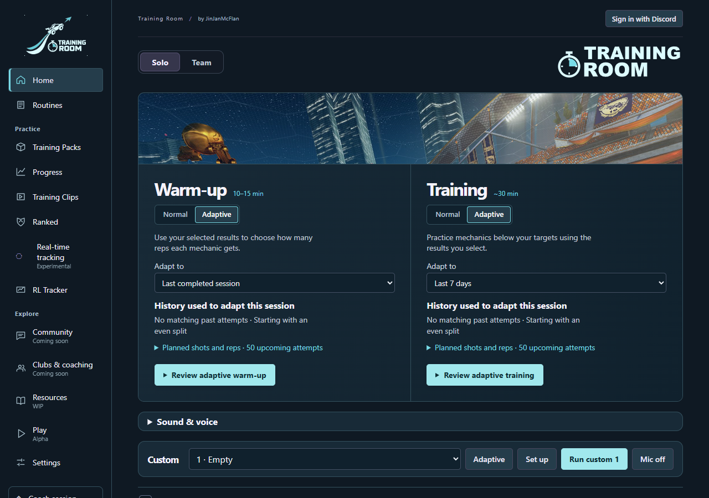
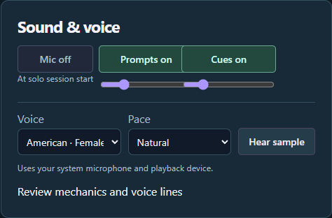

# Start here: Training Room on Windows

## 1. Get the app

Open the [Training Room download page](https://github.com/JinJanMcFlan/training-room-downloads/releases/tag/v1.0.13).

Look under **Assets**. Click the file that starts with **Training-Room-Setup** and ends in **.exe**.

Do not choose “Source code.” That is not the app.

## 2. Install it

Open your **Downloads** folder. Double-click the setup file.

When Training Room asks to install, click **OK**. Let it finish. The app should open.

If Windows shows a warning you do not understand, stop and send JinJanMcFlan a picture. Do not download a different copy from a search result.

## 3. Sign in

Click **Sign in with Discord** at the top right.

Use your own Discord account. Follow the sign-in page, then return to Training Room.

This test is for invited users. If your account cannot sign in, ask JinJanMcFlan for access.

*These are real pictures from the app's test browser view. The Windows app also has its own window buttons.*

## 4. Check the sound

Open **Settings**, then find **Sound & voice**.

Turn **Prompts on** and **Cues on**. Click **Hear sample**. Set the volume to a good level.

You can leave **Mic off** for your first test. The buttons work without a microphone.

## 5. Try a short warm-up

Go to **Home**. In the **Warm-up** box, choose **Normal**.

Click its review button. Check the shots, then start the warm-up.

Open Rocket League and enter Free Play. Try the shot shown in Training Room.

- Got it? Log a **Hit**.
- Missed it? Log a **Miss**.
- You can use the app's large buttons for your first test.

The usual keys are **Z** for Hit and **X** for Miss. If **Typing mode** is on, hold **Ctrl** with the key. Your screen shows the keys for your current setup.

Use **Ctrl + Shift + Space** to show or hide the game overlay. Borderless mode is the best first test. Fullscreen behavior still needs real-game testing.

When you are done, click **Finish session** near the top of Active View. Open **Progress** to see your saved results.

## 6. Update later

Open **Settings → Updates**. Click **Check for updates**.

Finish your session before you close and reopen the app to install an update. You can read what changed in **Update history**.

## Need help?

If you see “server unreachable,” ask JinJanMcFlan whether the server is running. Reinstalling usually will not fix an offline server.

Send JinJanMcFlan a picture of the problem and say what you clicked. Please do not send passwords or sign-in codes.

[Join the Discord](https://discord.gg/EjcegvkGUA) · Email: jinjanmcflan@gmail.com

[Privacy for invited testers](PRIVACY.md) · [Help and testing](SUPPORT.md) · [Invited-test terms](TERMS.md)
